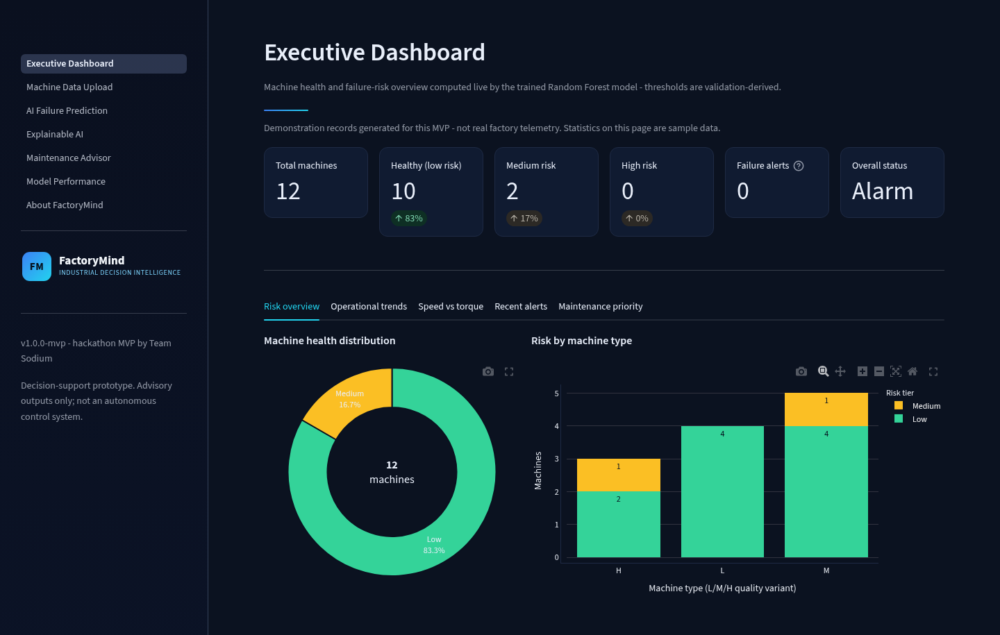
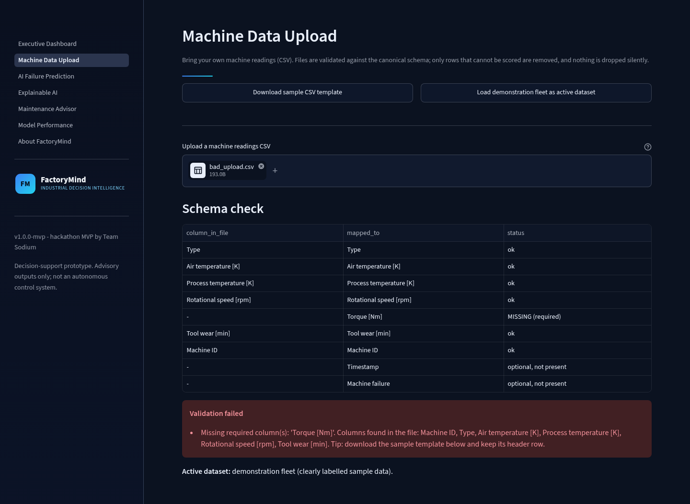
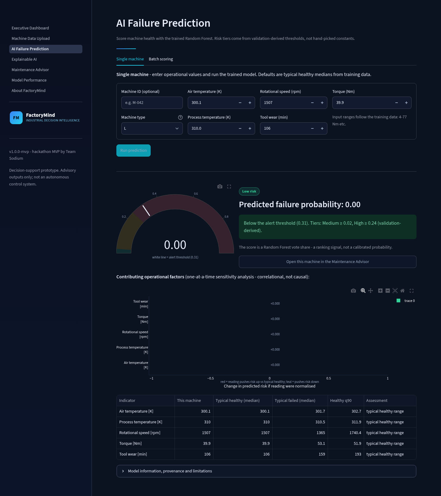
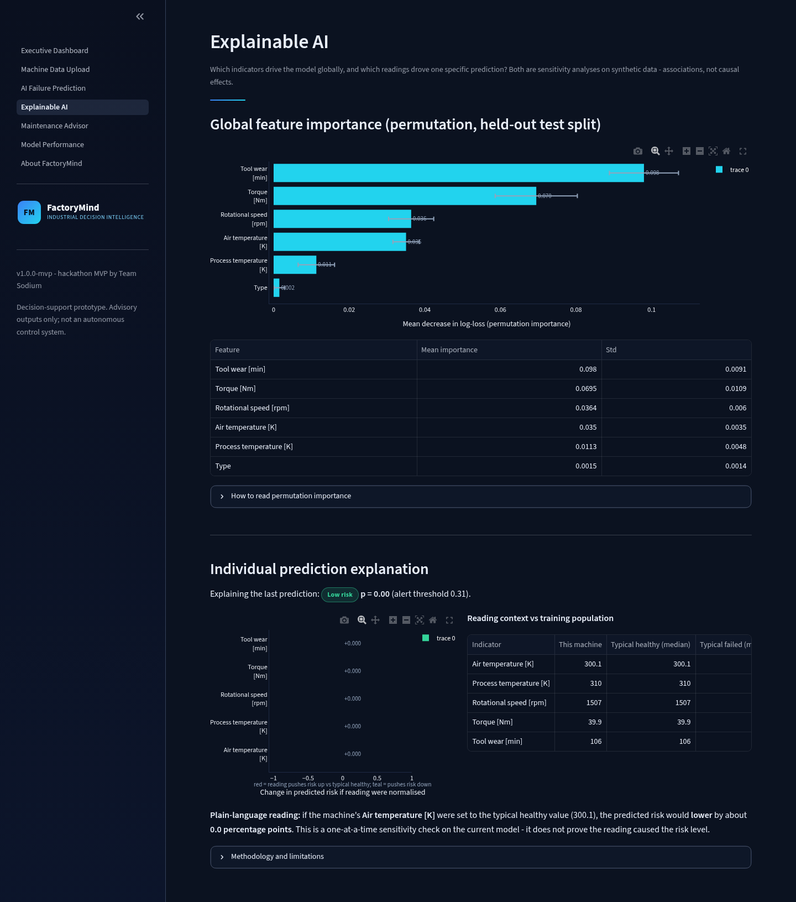
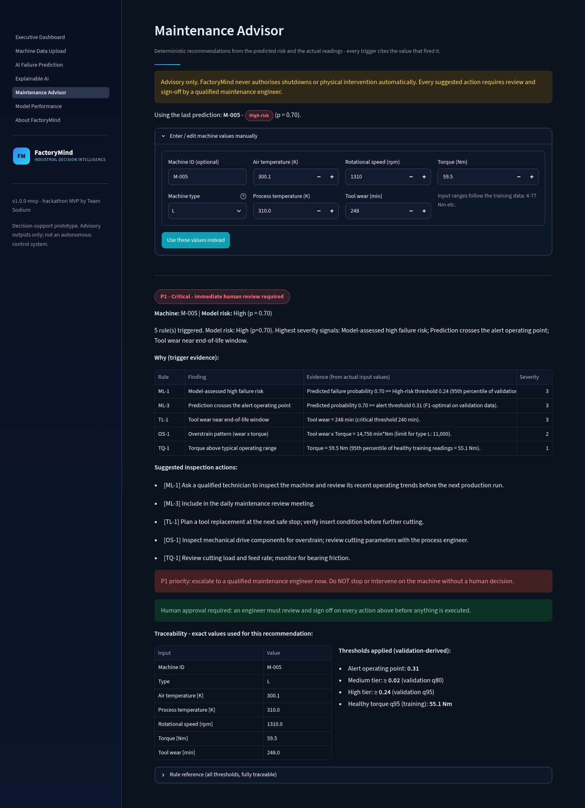
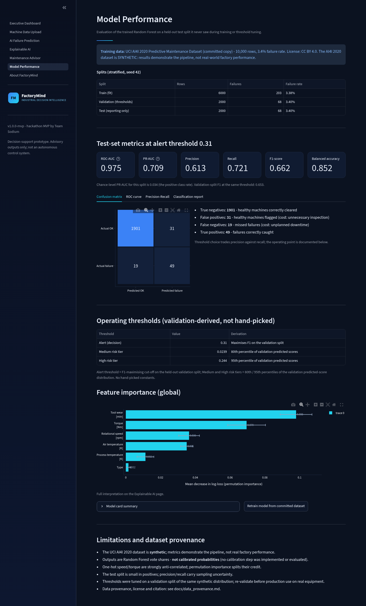
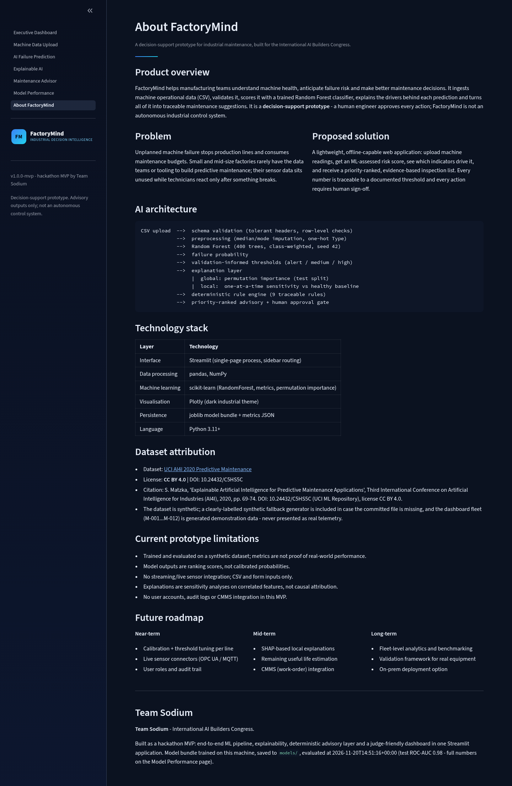

# FactoryMind

**AI-Powered Industrial Decision Intelligence**

A hackathon MVP by **Team Sodium** for the International AI Builders Congress.

FactoryMind helps manufacturing teams understand machine health, anticipate
failure risk and make better maintenance decisions. It ingests machine
operational data (CSV), validates it, scores it with a trained Random Forest
classifier, explains the drivers behind each prediction and turns all of it
into traceable maintenance suggestions with a human-approval gate.

> **What this is:** a decision-support prototype. Every prediction and
> recommendation is advisory and requires review by a qualified engineer.
> FactoryMind never authorises shutdowns or physical intervention.
>
> **Honesty note:** the model is trained on the UCI AI4I 2020 dataset, which
> is **synthetic**. Metrics below are real evaluation results on a held-out
> test split, but they are **not** proof of real-world factory performance.

---

## Screenshots

| | |
|---|---|
|  |  |
| *Executive Dashboard - live KPIs, risk distribution and demo-fleet trends* | *Machine Data Upload - schema check catching a missing required column* |
|  |  |
| *AI Failure Prediction - gauge, validation-derived tiers, contributing factors* | *Explainable AI - permutation importance and one-at-a-time local explanations* |
|  |  |
| *Maintenance Advisor - P1 recommendation with rule evidence and approval gate* | *Model Performance - real evaluation numbers, confusion matrix, ROC/PR* |



---

## Problem and solution

**Problem.** Unplanned machine failure stops production lines and consumes
maintenance budgets. Small and mid-size factories rarely have the data teams
or tooling to build predictive maintenance; their sensor data sits unused
while technicians react only after something breaks.

**Solution.** A lightweight, offline-capable web application: upload machine
readings, get an ML-assessed risk score, see which indicators drive it, and
receive a priority-ranked, evidence-based inspection list. Every number is
traceable to a documented threshold and every action requires human sign-off.

## Features

1. **Executive Dashboard** - total/healthy/medium/high-risk machines, failure
   alerts, overall status, health distribution, risk by machine type, 48-hour
   operational trends, recent alerts and a maintenance priority overview.
   Demo-fleet statistics are clearly labelled as demonstration records.
2. **Machine Data Upload** - CSV upload with tolerant header matching,
   row-level validation (missing/non-numeric readings, unknown machine type),
   out-of-range warnings, invalid-row report, sample template download and
   validated-data export. Understandable error messages throughout.
3. **AI Failure Prediction** - single-machine form plus batch scoring.
   Real Random Forest predictions, validation-informed risk tiers, alert
   threshold, contributing factors and a downloadable scored CSV.
4. **Explainable AI** - global permutation importance (held-out test split)
   and per-prediction one-at-a-time sensitivity analysis, with an explicit
   correlation-vs-causation disclaimer.
5. **Maintenance Advisor** - deterministic, traceable rule engine (9 rules)
   covering tool wear, heat dissipation, spindle power, overstrain, torque
   anomalies and model risk. Priority P1-P4, evidence from actual input
   values, human-approval requirement on every action.
6. **Model Performance** - dataset provenance, split sizes, real metrics,
   confusion matrix, ROC and precision-recall curves, threshold derivations,
   retrain button, limitations.
7. **About FactoryMind** - product story, architecture, stack, dataset
   attribution, limitations, roadmap, team.

## Installation

Requires Python 3.11+ (developed and tested on Python 3.12, scikit-learn 1.5.2).

```bash
git clone <your-repo-url> factorymind
cd factorymind
python -m venv .venv && source .venv/bin/activate   # optional
pip install -r requirements.txt
```

## Run

```bash
streamlit run app.py
```

Open http://localhost:8501. On first start the app loads the committed model
bundle (`models/factorymind_model.joblib`). If the bundle or dataset is
missing, FactoryMind **retrains automatically** from the committed dataset -
a fresh deployment needs no manual step.

Useful dev commands:

```bash
python -m src.model                 # train + print evaluation summary
python scripts/generate_demo_data.py  # regenerate the demo fleet + CSV template
python scripts/download_dataset.py  # re-download the UCI dataset into data/
python -m pytest tests -q           # run the test suite (16 tests)
```

## Dataset source and license

- Dataset: [UCI AI4I 2020 Predictive Maintenance Dataset](https://archive.ics.uci.edu/dataset/601/ai4i+2020+predictive+maintenance+dataset)
- License: [CC BY 4.0](https://creativecommons.org/licenses/by/4.0/) - DOI: 10.24432/C5HS5C
- Citation: S. Matzka, "Explainable Artificial Intelligence for Predictive
  Maintenance Applications," Third International Conference on Artificial
  Intelligence for Industries (AI4I), 2020, pp. 69-74.
- 10,000 rows, 14 columns, 3.39% failure rate. The committed copy in
  `data/ai4i2020.csv` is byte-identical to the original download
  (sha256 starts `dc6630cd9b1f0f85`); see `docs/data_provenance.md`.
- **Critical leakage prevention:** only `Type`, `Air temperature [K]`,
  `Process temperature [K]`, `Rotational speed [rpm]`, `Torque [Nm]` and
  `Tool wear [min]` are used as model input. The failure-mode labels
  (TWF, HDF, PWF, OSF, RNF) and identifiers (UDI, Product ID) are
  structurally excluded - enforced in `src/preprocessing.py` and tested.
- The dashboard fleet (`M-001`...`M-012`) is generated demonstration data and
  is labelled as such everywhere in the UI.

## Actual model evaluation results

Random Forest (400 trees, `min_samples_leaf=2`, `max_features="sqrt"`,
`class_weight="balanced_subsample"`, seed 42). Stratified 60/20/20
train/validation/test split (6,000 / 2,000 / 2,000 rows; 203 / 68 / 68
failures). Thresholds were tuned **only** on the validation split; the test
split was used exactly once, for reporting.

| Metric (test split) | Value |
|---|---|
| ROC-AUC | **0.976** |
| PR-AUC (average precision) | **0.709** (chance level: 0.034) |
| Precision @ alert threshold 0.31 | **0.613** |
| Recall @ alert threshold 0.31 | **0.721** |
| F1-score @ alert threshold 0.31 | **0.662** |
| Balanced accuracy | **0.852** |

Confusion matrix (test, at the alert threshold): true negatives **1901**,
false positives **31**, false negatives **19**, true positives **49**.

Operating thresholds (all derived from validation data, nothing hand-picked):

| Threshold | Value | Derivation |
|---|---|---|
| Alert (decision) | 0.31 | maximises F1 on the validation split |
| Medium risk tier | 0.024 | 80th percentile of validation predicted scores |
| High risk tier | 0.244 | 95th percentile of validation predicted scores |

Permutation importance (mean decrease in log-loss, 8 repeats, test split):
Tool wear 0.098 > Torque 0.070 > Rotational speed 0.036 > Air temperature
0.035 > Process temperature 0.011 > Type 0.002.

These numbers are produced by the committed model bundle and reproducible via
`python -m src.model` / `python -m pytest tests -q`.

## Model limitations

- The UCI AI4I 2020 dataset is **synthetic**; metrics demonstrate the
  pipeline, not real factory performance.
- Outputs are Random Forest vote shares - **not calibrated probabilities**
  (no calibration step was implemented or evaluated).
- Strong speed/torque anti-correlation means permutation importance shares
  credit between correlated features.
- Explanations are sensitivity analyses of model behaviour - **not causal**.
- Thresholds are tuned on a validation split of the same synthetic
  distribution; re-validate before any production use on real equipment.
- No streaming sensor integration, user accounts, audit logs or CMMS
  connectors in this MVP.

## Deployment

### Streamlit Community Cloud (recommended)

1. Push this repository to GitHub (the repo includes `requirements.txt`,
   the dataset and the trained model bundle, so a cold start works offline).
2. On https://share.streamlit.io choose **New app**, pick the repository,
   branch `main` and main file `app.py`, then deploy.
3. First deploy trains nothing (bundle is committed) and boots in seconds.
   If you delete `models/factorymind_model.joblib`, the app retrains
   automatically on startup (~1-2 minutes on a free instance).

No secrets, no paid APIs, no environment variables required.

### Docker-style local / VPS

```bash
pip install -r requirements.txt
streamlit run app.py --server.port 8501 --server.address 0.0.0.0
```

### Replit

A `.replit` configuration is included. Import the repo in Replit, press Run;
the app serves on port 8501 (mapped to the web preview).

### GitHub

1. Create a new repository and push this folder:

   ```bash
   cd factorymind
   git init && git add . && git commit -m "FactoryMind MVP - Team Sodium"
   git remote add origin <your-repo-url>
   git push -u origin main
   ```

2. `.gitignore` covers caches, virtualenvs and `.streamlit/secrets.toml`.
   `data/ai4i2020.csv` (~0.5 MB) and `models/factorymind_model.joblib` are
   committed intentionally so deployments are reproducible.

## Project structure

```
factorymind/
    app.py                  # entry point + sidebar navigation (st.navigation)
    requirements.txt
    README.md
    LICENSE                 # MIT (code); dataset is CC BY 4.0 (see docs/)
    .replit                 # Replit run configuration
    .streamlit/config.toml  # dark industrial theme
    src/
        config.py           # paths, features, leakage policy, rule thresholds
        data_loader.py      # loading, CSV validation, synthetic fallbacks
        model.py            # pipeline, training, thresholds, evaluation
        prediction.py       # single/batch scoring + local explanations
        recommendations.py  # deterministic maintenance rule engine
        explainability.py   # (planned split-out; logic lives in model/prediction)
        visualization.py    # Plotly figure factory (dark industrial theme)
        widgets.py          # reusable Streamlit UI blocks
    pages/                  # one render() module per app page
    data/                   # ai4i2020.csv (UCI), sample_data.csv, template
    models/                 # factorymind_model.joblib + metrics.json
    docs/                   # architecture.md, model_card.md, data_provenance.md
    scripts/                # dataset download + demo data generation
    tests/                  # pytest suite (16 tests)
    screenshots/            # README evidence
```

## Team: Sodium

Built by **Team Sodium** for the International AI Builders Congress as a
judge-ready MVP: end-to-end ML pipeline, explainability, a deterministic
advisory layer and a professional dashboard in one Streamlit application.
